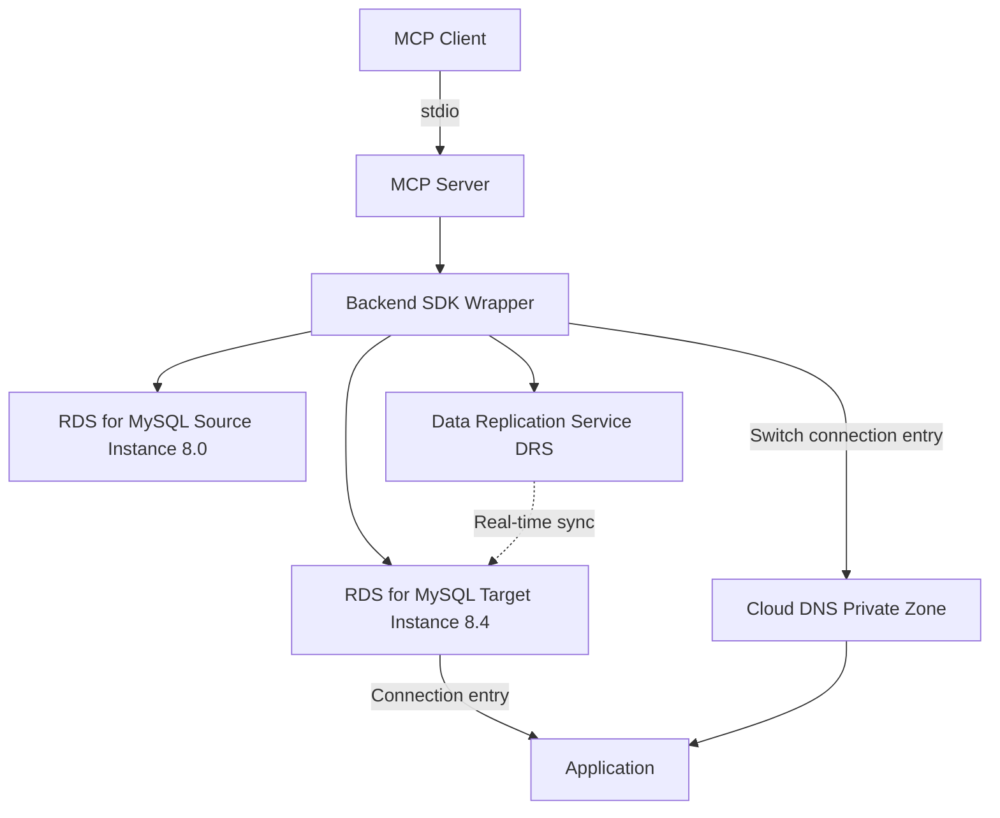

# RDS for MySQL Major Version Upgrade Assistant

> A best practice for low-downtime batch upgrades of RDS for MySQL 8.0 → 8.4 on Huawei Cloud: MCP tools orchestrate instance discovery, compatibility precheck, green environment creation, real-time sync, connection switchover, validation, and cleanup.

[](https://img.shields.io/badge/license-MIT%20No%20Attribution-green.svg)
[](https://img.shields.io/badge/Huawei%20Cloud-Compatible-red.svg)
[](https://img.shields.io/badge/MySQL-8.0%20to%208.4-blue.svg)

## 2. Introduction

This solution is a major version (8.0 → 8.4) upgrade assistant for Huawei Cloud RDS for MySQL. It exposes upgrade tools as an MCP Server that clients such as Claude Desktop / Cursor can call, covering the complete flow of "discover instances → compatibility precheck → create a target-version instance and sync in real time → switch the connection entry → validate → clean up". It suits operations and architecture scenarios that require low-downtime major version upgrades for a batch of MySQL instances.

## 3. Table of Contents

- [2. Introduction](#2-introduction)
- [4. Architecture Diagram](#4-architecture-diagram)
- [5. Solution Highlights](#5-solution-highlights)
- [6. Cloud Services Involved](#6-cloud-services-involved)
- [7. Prerequisites](#7-prerequisites)
- [8. Quick Start](#8-quick-start)
- [9. Step-by-Step Deployment](#9-step-by-step-deployment)
- [10. Usage and Verification](#10-usage-and-verification)
- [11. Resource Cleanup](#11-resource-cleanup)
- [12. Detailed Description](#12-detailed-description)
- [13. Dependencies and Acknowledgments](#13-dependencies-and-acknowledgments)
- [14. FAQ / Troubleshooting](#14-faq--troubleshooting)
- [15. Contributing Guidelines](#15-contributing-guidelines)
- [16. License](#16-license)
- [17. Submitter](#17-submitter)

## 4. Architecture Diagram



## 5. Solution Highlights

- **Low-downtime major version upgrade**: builds a self-managed blue/green flow with "target instance + real-time sync + connection entry switchover", compressing the downtime window of a major version upgrade down to the switchover moment.
- **MCP tool-based orchestration**: each upgrade step is exposed as an MCP tool and can be orchestrated directly by AI clients; batch scenarios support configuration-driven concurrency.
- **Compatibility precheck first**: before the upgrade, a MySQL 8.0→8.4 compatibility check is run against the source instance (character set, sql_mode, reserved words, views) to reduce post-switchover failure rates.
- **Rollback capable**: the source instance and a reverse sync task are retained before switchover; pointing the connection entry back to the source rolls the change back.
- **Credentials never written to disk**: instance passwords and access keys are injected from environment variables at runtime only, meeting the security red line.

## 6. Cloud Services Involved

- **RDS for MySQL**: source / target database instances (core)
- **Data Replication Service (DRS)**: full + incremental sync between the source and target instances
- **Cloud DNS Private Zone**: optional; updates private domain records during switchover
- **Identity and Access Management (IAM)**: operation permissions and temporary credentials
- **Virtual Private Cloud (VPC) / security groups**: instance networking and access control

## 7. Prerequisites

- Python ≥ 3.10
- The `mysql` client is installed (for local precheck / validation SQL)
- A Huawei Cloud account with RDS for MySQL and DRS permissions in the target region (default `cn-north-4`)
- Environment variables are configured (real values are injected through environment variables; writing them to files is prohibited):

```bash
export HW_ACCESS_KEY=<HW_ACCESS_KEY>
export HW_SECRET_KEY=<HW_SECRET_KEY>
export HW_PROJECT_ID=<HW_PROJECT_ID>
export HW_REGION=cn-north-4
```

## 8. Quick Start

```bash
python -m pip install -e .
```

Register it in your MCP client configuration (stdio transport):

```json
{
  "mcpServers": {
    "rds-mysql-upgrade": {
      "command": "python",
      "args": ["-m", "rds_upgrade_mcp.server"]
    }
  }
}
```

## 9. Step-by-Step Deployment

```bash
# 1) Install dependencies
python -m pip install -e .

# 2) Configure the MCP client (see mcp.json in Chapter 8)
# 3) Call the tools in the client to complete the upgrade (see Chapter 10)
#    discover → precheck → create green + sync → monitor → switchover → validate → cleanup

# Optional: use Terraform to create a test target environment
cd infra
terraform init && terraform apply -var="db_password=<DB_PASSWORD>"
```

## 10. Usage and Verification

Call the following in your MCP client in order:

```text
discover_instances(region="cn-north-4")                       # list instances to upgrade
run_precheck(host="<source instance IP>", user="root", password="<DB_PASSWORD>")   # compatibility precheck
create_blue_green(instance_id="<source ID>", target_version="8.4", green_password="<DB_PASSWORD>")  # create green + sync
monitor_blue_green(deployment_id="<DRS task ID>")              # wait for sync to be ready
switchover(deployment_id="<DRS task ID>", update_dns=true)     # switch the connection entry
validate_upgrade(instance_id="<green ID>", expected_version="8.4")  # version validation
cleanup_blue_green(deployment_id="<DRS task ID>")              # release resources
```

Verification points:

- `validate_upgrade` returns `passed=true` and `engine_version` starts with `8.4`.
- The SQL output of `run_precheck` / `app_validate` contains no errors, and business tables are accessible.
- After switchover, applications connect through the new endpoint; the original connection entry can be retained for rollback.

> After deployment, perform the verification steps in this section yourself and confirm that the business functionality works. Only then is the delivery considered complete.

## 11. Resource Cleanup

- Upgrade assistant: `cleanup_blue_green` stops the DRS task and deletes the green instance; once you have confirmed everything, `delete_source=true` deletes the source instance.
- Sample environment: `cd infra && terraform destroy -var="db_password=<DB_PASSWORD>"` releases the test instances and avoids leftovers.

## 12. Detailed Description

**Directory Structure**

```
sample-rds-mysql-upgrade-assistant/
├── LICENSE                  # MIT No Attribution (Huawei Cloud copyright)
├── README.md
├── pyproject.toml
├── docs/
│   ├── architecture.md       # Architecture description
│   └── deployment-guide.md    # Deployment guide
├── infra/                   # Sample Terraform
├── src/
│   └── rds_upgrade_mcp/      # MCP Server + backend SDK wrapper
└── scripts/
    ├── precheck/             # MySQL compatibility precheck SQL
    └── validate/             # Application validation SQL
```

**Upgrade workflow key points**: discovery → precheck (character set / sql_mode / reserved words / views) → green creation (create a target-version instance based on the source topology) → DRS sync → monitoring (lag ≈ 0) → switchover (connection entry) → validation → cleanup. Huawei Cloud RDS for MySQL provides major version upgrade capability; this solution achieves a low-downtime switchover through "target instance + real-time sync + connection entry switchover".

**Quality gates**: credentials never written to disk (C8), billable specifications explicitly hardcoded (C9), runtime-mutable fields use `ignore_changes` (C10), no upstream license attribution left in the product (C12), cost information stored only in `others/` (C13).

## 13. Dependencies and Acknowledgments

- **Dependencies**: `mcp[cli]` (MCP Server framework), `huaweicloudsdkcore` / `huaweicloudsdkrds` / `huaweicloudsdkdrs` / `huaweicloudsdkiam` (Huawei Cloud SDK).
- **Acknowledgments**: the MySQL 8.0→8.4 compatibility check items reference the general recommendations in the official MySQL upgrade documentation.

## 14. FAQ / Troubleshooting

- **Switchover is not atomic**: applications must reconnect on their own after the connection entry is switched; run the switchover during off-peak hours and notify stakeholders in advance.
- **Sync lag does not converge**: check the write pressure on the source instance, the network, and the DRS link; increase the sync specification if necessary.
- **Insufficient permissions**: confirm that the account holds operation permissions for RDS, DRS, networking, and DNS.
- **Precheck reports errors**: fix character set / reserved word / view compatibility issues first, then run the upgrade.

## 15. Contributing Guidelines

This solution is maintained alongside its companion tooling repository. To contribute, refer to the repository's `CONTRIBUTING.md` (if applicable).

## 16. License

[](https://img.shields.io/badge/license-MIT%20No%20Attribution-green.svg)

This solution is released under the **MIT No Attribution** license (Huawei Cloud copyright).

## 17. Submitter

- **Submitter**: zhangcheng123321
