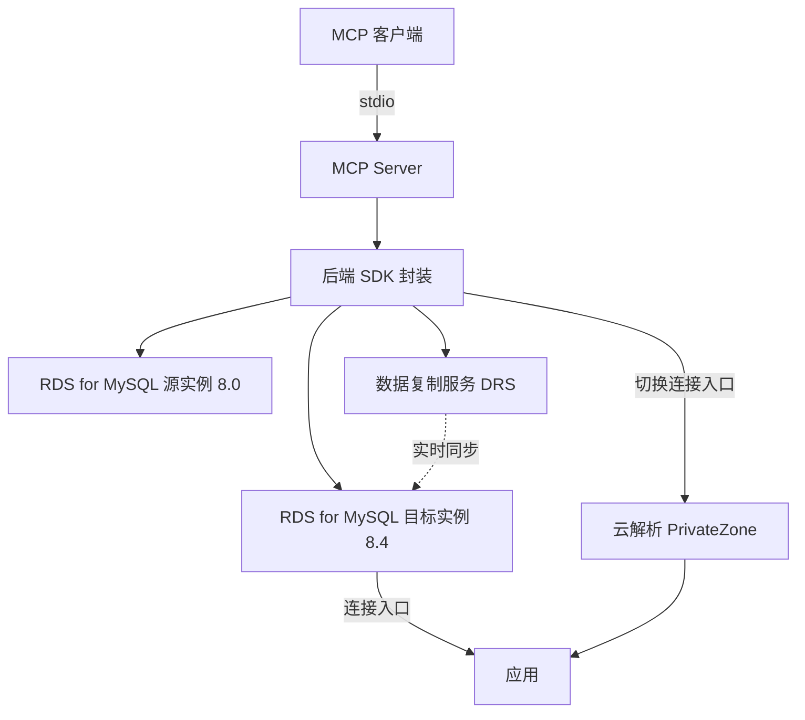

# RDS for MySQL 大版本升级助手

> 在华为云上落地一套 RDS for MySQL 8.0 → 8.4 低中断批量升级最佳实践：通过 MCP 工具编排实例发现、兼容性预检、建绿环境、实时同步、连接切换、验证与清理。

[](https://img.shields.io/badge/license-MIT%20No%20Attribution-green.svg)
[](https://img.shields.io/badge/Huawei%20Cloud-Compatible-red.svg)
[](https://img.shields.io/badge/MySQL-8.0%20to%208.4-blue.svg)

## 2. 简介

本实践是一个面向华为云 RDS for MySQL 的大版本（8.0 → 8.4）升级助手。它以 MCP Server 形式暴露升级工具，供 Claude Desktop / Cursor 等客户端调用，覆盖「发现实例 → 兼容性预检 → 新建目标版本实例并实时同步 → 切换连接入口 → 验证 → 清理」的完整流程，适合需要对一批 MySQL 实例做低中断主版本升级的运维与架构场景。

## 3. 目录

- [2. 简介](#2-简介)
- [4. 架构图](#4-架构图)
- [5. 方案亮点](#5-方案亮点)
- [6. 涉及云服务](#6-涉及云服务)
- [7. 前置条件](#7-前置条件)
- [8. 快速开始](#8-快速开始)
- [9. 分步部署](#9-分步部署)
- [10. 使用方法与验证](#10-使用方法与验证)
- [11. 清理资源](#11-清理资源)
- [12. 详细说明](#12-详细说明)
- [13. 依赖与致谢](#13-依赖与致谢)
- [14. 常见问题与故障排除](#14-常见问题与故障排除)
- [15. 贡献指南](#15-贡献指南)
- [16. 许可证](#16-许可证)
- [17. 提交者](#17-提交者)

## 4. 架构图



## 5. 方案亮点

- **低中断主版本升级**：以「目标实例 + 实时同步 + 连接入口切换」自建蓝绿流程，将大版本升级的停机窗口压缩到切换瞬间。
- **MCP 工具化编排**：升级各步骤以 MCP 工具暴露，可直接被 AI 客户端编排，批量场景支持配置驱动并发。
- **兼容性预检前置**：升级前对源实例执行 MySQL 8.0→8.4 兼容性检查（字符集、sql_mode、保留字、视图），降低切换后故障率。
- **可回滚**：切换前保留源实例与反向同步任务，连接入口指回源即可回滚。
- **凭据不落盘**：实例密码与访问密钥仅运行时从环境变量注入，符合安全红线。

## 6. 涉及云服务

- **RDS for MySQL**：源 / 目标数据库实例（核心）
- **数据复制服务 DRS**：源与目标实例间的全量 + 增量同步
- **云解析 PrivateZone**：可选，切换时更新私有域名记录
- **统一身份认证 IAM**：操作权限与临时凭证
- **虚拟私有云 VPC / 安全组**：实例网络与访问控制

## 7. 前置条件

- Python ≥ 3.10
- 已安装 `mysql` 客户端（本地预检 / 验证 SQL）
- 华为云账号，目标区域具备 RDS for MySQL、DRS 权限（默认 `cn-north-4`）
- 已配置环境变量（真实值从环境变量注入，禁止写入文件）：

```bash
export HW_ACCESS_KEY=<HW_ACCESS_KEY>
export HW_SECRET_KEY=<HW_SECRET_KEY>
export HW_PROJECT_ID=<HW_PROJECT_ID>
export HW_REGION=cn-north-4
```

## 8. 快速开始

```bash
python -m pip install -e .
```

在 MCP 客户端配置中注册（stdio 传输）：

```json
{
  "mcpServers": {
    "rds-mysql-upgrade": {
      "command": "python",
      "args": ["-m", "rds_upgrade_mcp.server"]
    }
  }
}
```

## 9. 分步部署

```bash
# 1) 安装依赖
python -m pip install -e .

# 2) 配置 MCP 客户端（见第 8 章 mcp.json）
# 3) 在客户端中调用工具完成升级（见第 10 章）
#    发现 → 预检 → 建绿+同步 → 监测 → 切换 → 验证 → 清理

# 可选：用 Terraform 创建测试目标环境
cd infra
terraform init && terraform apply -var="db_password=<DB_PASSWORD>"
```

## 10. 使用方法与验证

在 MCP 客户端中依次调用：

```text
discover_instances(region="cn-north-4")                       # 列出待升级实例
run_precheck(host="<源实例IP>", user="root", password="<DB_PASSWORD>")   # 兼容性预检
create_blue_green(instance_id="<源ID>", target_version="8.4", green_password="<DB_PASSWORD>")  # 建绿+同步
monitor_blue_green(deployment_id="<DRS任务ID>")                # 等待同步就绪
switchover(deployment_id="<DRS任务ID>", update_dns=true)      # 切换连接入口
validate_upgrade(instance_id="<greenID>", expected_version="8.4")  # 版本验证
cleanup_blue_green(deployment_id="<DRS任务ID>")               # 释放资源
```

验证要点：

- `validate_upgrade` 返回 `passed=true` 且 `engine_version` 以 `8.4` 开头。
- `run_precheck` / `app_validate` 的 SQL 输出无报错，业务表可访问。
- 切换后应用以新端点连入，原连接入口可保留作回滚。

> 部署完成后请按本节步骤自行验证，确认业务功能可用，方可视为交付完成。

## 11. 清理资源

- 升级助手：`cleanup_blue_green` 停止 DRS 任务并删除 green 实例；确认无误后 `delete_source=true` 删除源实例。
- 示例环境：`cd infra && terraform destroy -var="db_password=<DB_PASSWORD>"`，释放测试实例，避免残留。

## 12. 详细说明

**目录结构**

```
sample-rds-mysql-upgrade-assistant/
├── LICENSE                  # MIT No Attribution（Huawei Cloud 版权）
├── README.md
├── pyproject.toml
├── docs/
│   ├── architecture.md       # 架构说明
│   └── deployment-guide.md    # 部署指导书
├── infra/                   # 示例 Terraform
├── src/
│   └── rds_upgrade_mcp/      # MCP Server + 后端 SDK 封装
└── scripts/
    ├── precheck/             # MySQL 兼容性预检 SQL
    └── validate/             # 应用验证 SQL
```

**升级流程要点**：发现 → 预检（字符集 / sql_mode / 保留字 / 视图）→ 建绿（按源拓扑新建目标版本实例）→ DRS 同步 → 监测（延迟≈0）→ 切换（连接入口）→ 验证 → 清理。华为云 RDS for MySQL 提供主版本升级能力，本实践以「目标实例 + 实时同步 + 连接入口切换」实现低中断切换。

**质量门禁**：凭据不落盘（C8）、计费规格显式写死（C9）、运行期可变字段 `ignore_changes`（C10）、产品侧不残留上游许可证署名（C12）、费用信息仅存 `others/`（C13）。

## 13. 依赖与致谢

- **依赖**：`mcp[cli]`（MCP Server 框架）、`huaweicloudsdkcore` / `huaweicloudsdkrds` / `huaweicloudsdkdrs` / `huaweicloudsdkiam`（华为云 SDK）。
- **致谢**：MySQL 8.0→8.4 兼容性检查项参考 MySQL 官方升级文档的通用建议。

## 14. 常见问题与故障排除

- **切换非原子**：连接入口切换后应用需主动重连；建议在低峰期执行并提前通知。
- **同步延迟不收敛**：检查源实例写入压力、网络与 DRS 链路；必要时提升同步规格。
- **权限不足**：确认账号具备 RDS、DRS、网络与解析相关操作权限。
- **预检报错**：先修复字符集 / 保留字 / 视图兼容性问题，再执行升级。

## 15. 贡献指南

本实践随配套工具仓库维护。如需贡献，请参考仓库 `CONTRIBUTING.md`（如适用）。

## 16. 许可证

[](https://img.shields.io/badge/license-MIT%20No%20Attribution-green.svg)

本实践采用 **MIT No Attribution** 许可证（Huawei Cloud 版权）。

## 17. 提交者

- **提交者**：zhangcheng123321
